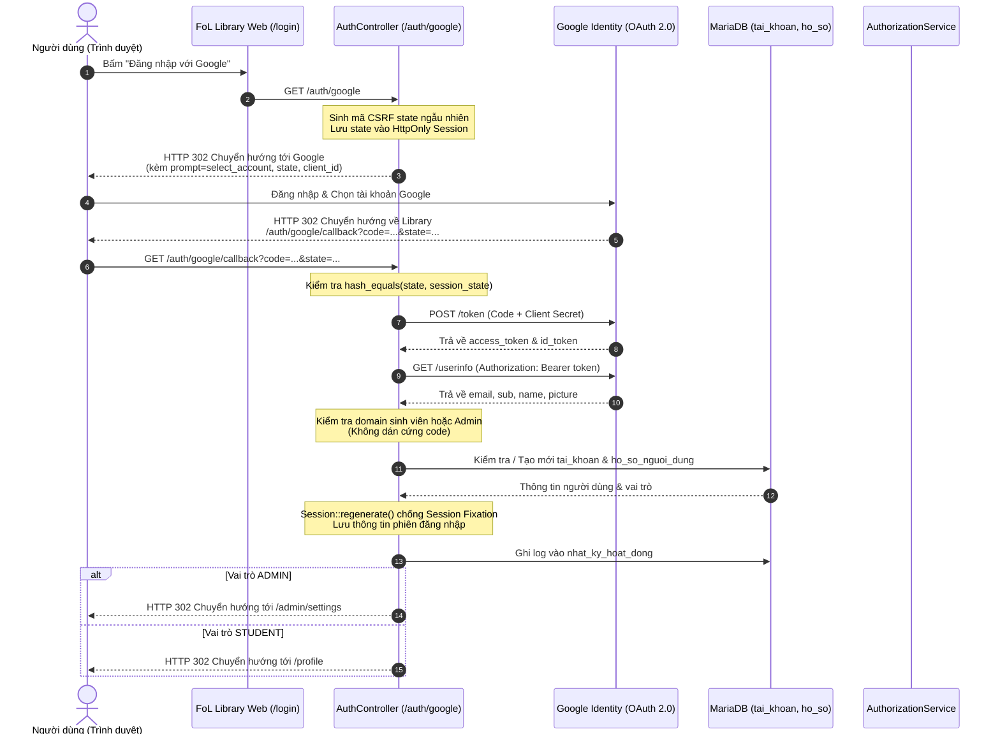

# TÀI LIỆU THIẾT KẾ VÀ TÍCH HỢP XÁC THỰC GOOGLE OAUTH 2.0 / OPENID CONNECT

**Dự án:** Website Thư viện số FoL (Faculty of Law / Digital Library)  
**Phiên bản:** 1.0  
**Ngày hoàn thiện:** 29/10/2026  
**Công nghệ:** PHP 8.x MVC (OOP thuần, không phụ thuộc Composer), Google Identity & OAuth 2.0 v2 API, MariaDB 10.4, Tailwind CSS  
**Tiêu chuẩn bảo mật:** OAuth 2.0, OpenID Connect, CSRF State Protection, Session Fixation Prevention, Dynamic RBAC Enforcement

---

## 1. Tổng quan và Mục tiêu Thiết kế

### 1.1. Mục tiêu
Hệ thống Thư viện số FoL yêu cầu cơ chế xác thực an toàn, tiện lợi cho sinh viên và cán bộ quản trị:
- **Trải nghiệm đăng nhập nhanh:** Sinh viên và quản trị viên có thể sử dụng tài khoản Google để đăng nhập chỉ bằng 1 cú click.
- **Lựa chọn tài khoản linh hoạt:** Bắt buộc xuất hiện màn hình chọn tài khoản Google (`prompt=select_account`) giúp người dùng chuyển đổi tài khoản cá nhân và tài khoản trường mà không bị tự động lưu phiên ngoài ý muốn.
- **Kiểm soát tên miền chặt chẽ (Zero Hardcoding):** 
  - Chỉ cho phép 2 tên miền sinh viên: `@gm.uit.edu.vn` (ĐH Công nghệ Thông tin) và `@sv.ussh.edu.vn` (ĐH Khoa học Xã hội và Nhân văn).
  - Tách bạch tài khoản Quản trị viên (`ADMIN`) qua cấu hình môi trường, không dán cứng bất kỳ email nào trong mã nguồn PHP.
- **Phân quyền động kết hợp RBAC:** Phân biệt rõ vai trò ngay sau khi xác thực thành công (Admin chuyển hướng về `/admin/settings`, Sinh viên chuyển hướng về `/profile`).
- **An toàn bảo mật thông tin tuyệt đối:** Toàn bộ khóa bí mật (`Client Secret`) chỉ lưu trữ tại môi trường cục bộ (`.env`), được Git bỏ qua (`.gitignore`), tuyệt đối không đưa lên kho chứa mã nguồn GitHub.

---

## 2. Luồng Xử lý Xác thực (Authentication Flow)

Hệ thống tuân thủ nghiêm ngặt chuẩn **OAuth 2.0 Authorization Code Grant Flow** kết hợp **OpenID Connect**:



---

## 3. Kiến trúc Triển khai Chi tiết

### 3.1. Tầng Cấu hình & Biến môi trường (`.env` & `config/auth.php`)

Toàn bộ thông số xác thực được cô lập tại file biến môi trường, bảo vệ tuyệt đối theo Rule 5 của dự án:

#### File `.env` (Cục bộ trên máy/máy chủ - nằm trong `.gitignore`):
```env
# Google OAuth 2.0 Configuration (OpenID Connect)
GOOGLE_CLIENT_ID=your_client_id.apps.googleusercontent.com
GOOGLE_CLIENT_SECRET=your_client_secret_token
GOOGLE_REDIRECT_URI=http://localhost:8000/auth/google/callback
GOOGLE_STUDENT_DOMAINS=gm.uit.edu.vn,sv.ussh.edu.vn
GOOGLE_ADMIN_EMAILS=admin@fol.uit.edu.vn,nguyendoanduchieu16112006@gmail.com
```

#### File `config/auth.php`:
Tự động nạp giá trị từ `$_ENV` và hàm `getenv()`:
```php
<?php

declare(strict_types=1);

return [
    'google' => [
        'client_id' => $_ENV['GOOGLE_CLIENT_ID'] ?? getenv('GOOGLE_CLIENT_ID') ?: '',
        'client_secret' => $_ENV['GOOGLE_CLIENT_SECRET'] ?? getenv('GOOGLE_CLIENT_SECRET') ?: '',
        'redirect_uri' => $_ENV['GOOGLE_REDIRECT_URI'] ?? getenv('GOOGLE_REDIRECT_URI') ?: 'http://localhost:8000/auth/google/callback',
        // Danh sách domain email trường được phép đăng ký/đăng nhập tài khoản sinh viên
        'student_domains' => array_filter(array_map('trim', explode(',', strtolower((string)($_ENV['GOOGLE_STUDENT_DOMAINS'] ?? 'gm.uit.edu.vn,sv.ussh.edu.vn'))))),
        // Danh sách email quản trị viên được phép đăng nhập Google với vai trò Admin
        'admin_emails' => array_filter(array_map('trim', explode(',', strtolower((string)($_ENV['GOOGLE_ADMIN_EMAILS'] ?? ''))))),
        'prompt' => 'select_account',
    ],
];
```

---

### 3.2. Dịch vụ Xử lý Google OAuth (`App\Services\GoogleAuthService`)

Class thuần PHP 8.x OOP độc lập, sử dụng thư viện `curl` và `openssl` tích hợp sẵn của PHP:

1. **`isConfigured(): bool`**  
   Kiểm tra xem hệ thống đã được điền đủ `Client ID` và `Client Secret` hay chưa. Nếu chưa, thông báo lỗi thân thiện được hiển thị tại màn hình đăng nhập.
2. **`createAuthUrl(string $state): string`**  
   Khởi tạo đường dẫn chuyển hướng sang `https://accounts.google.com/o/oauth2/v2/auth` với các tham số bắt buộc:
   - `client_id`: Định danh ứng dụng của thư viện trên Google Cloud.
   - `redirect_uri`: Địa chỉ callback tiếp nhận kết quả (`/auth/google/callback`).
   - `response_type=code`: Nhận mã ủy quyền qua luồng Server-side.
   - `scope=openid email profile`: Yêu cầu quyền đọc mã định danh, email và họ tên cơ bản.
   - `prompt=select_account`: Buộc Google luôn hiển thị hộp thoại chọn tài khoản.
   - `state`: Chuỗi token chống giả mạo yêu cầu (CSRF).
3. **`exchangeAndVerify(string $code): array`**  
   Thực hiện gửi yêu cầu POST an toàn (có xác thực chứng chỉ SSL `CURLOPT_SSL_VERIFYPEER => true`) tới máy chủ Google để đổi Authorization Code lấy Access Token, sau đó gọi UserInfo Endpoint để xác thực tính hợp lệ của email (`email_verified === true`).
4. **`isStudentDomain(string $email): bool`**  
   Kiểm tra tên miền email người dùng có thuộc danh sách `['gm.uit.edu.vn', 'sv.ussh.edu.vn']` hay không (không phân biệt chữ hoa/thường).
5. **`isAdminEmail(string $email): bool`**  
   Kiểm tra địa chỉ email có nằm trong danh sách Quản trị viên được chỉ định qua biến môi trường hay không.
6. **`isAllowed(string $email): bool`**  
   Hợp nhất điều kiện: cho phép đăng nhập nếu là tài khoản Admin hoặc là Sinh viên thuộc 2 trường đại học được chỉ định.

---

### 3.3. Tầng Điều khiển (`App\Controllers\AuthController`)

Điều phối toàn bộ luồng đăng nhập tại 2 hành động:

* **`googleRedirect(): void`**
  ```php
  public function googleRedirect(): void
  {
      if (!$this->googleAuthService->isConfigured()) {
          header('Location: /login?error=' . urlencode('Chưa cấu hình Google OAuth Client ID/Secret.'));
          exit;
      }
      $state = bin2hex(random_bytes(32));
      Session::set('google_oauth_state', $state);
      header('Location: ' . $this->googleAuthService->createAuthUrl($state));
      exit;
  }
  ```

* **`googleCallback(): void`**
  1. **Bảo vệ CSRF:** So sánh `state` trả về từ Google với `$_SESSION['google_oauth_state']` bằng hàm so sánh an toàn thời gian thực `hash_equals()`.
  2. **Trao đổi Token:** Gọi `exchangeAndVerify($code)` để nhận payload hồ sơ từ Google.
  3. **Kiểm tra quyền hạn động:**
     - Xác định người dùng có phải là Sinh viên hợp lệ hoặc Quản trị viên hay không.
     - Nếu không thỏa mãn: Chặn truy cập và thông báo rõ lý do tên miền.
  4. **Tra cứu & Khởi tạo tài khoản CSDL:**
     - Tìm kiếm theo `google_sub` (mã định danh duy nhất của Google).
     - Nếu chưa có, tìm theo `email` để liên kết `google_sub` vào tài khoản sẵn có.
     - Nếu là người dùng mới: Tự động khởi tạo tài khoản trong bảng `tai_khoan` và hồ sơ tương ứng trong `ho_so_nguoi_dung` với vai trò tương ứng (Admin cấp `id_vai_tro = 1`, Sinh viên cấp `id_vai_tro = 3`).
  5. **Chống tấn công Session Fixation:** Gọi `Session::regenerate()` để làm mới định danh phiên ngay khi đăng nhập thành công.
  6. **Ghi nhận kiểm toán:** Lưu nhật ký hành động `DangNhapGoogleOAuth` vào bảng `nhat_ky_hoat_dong`.
  7. **Điều hướng theo vai trò (Role-based Routing):**
     - Vai trò `ADMIN` $\rightarrow$ Điều hướng về `/admin/settings`.
     - Vai trò `STUDENT` $\rightarrow$ Điều hướng về `/profile`.

---

## 4. Ma trận Quyền hạn và Dữ liệu Người dùng

| Loại tài khoản | Tiêu chí nhận diện (Cấu hình / CSDL) | Vai trò gán trong CSDL | Tiền tố MSSV/Mã CB | Trang đích sau đăng nhập | Quyền hạn RBAC |
| :--- | :--- | :---: | :---: | :---: | :--- |
| **Quản trị viên (Admin)** | Khai báo trong `GOOGLE_ADMIN_EMAILS` hoặc `id_vai_tro = 1` trong CSDL | `ADMIN` (1) | `ADxxxxx` | `/admin/settings` | Toàn quyền quản trị hệ thống (`setting.manage`, `user.manage`, ...) |
| **Sinh viên UIT** | Email có đuôi `@gm.uit.edu.vn` | `STUDENT` (3) | `SVxxxxx` | `/profile` | Mượn sách, đặt phòng/ghế đọc, quản lý yêu cầu cá nhân |
| **Sinh viên USSH** | Email có đuôi `@sv.ussh.edu.vn` | `STUDENT` (3) | `SVxxxxx` | `/profile` | Mượn sách, đặt phòng/ghế đọc, quản lý yêu cầu cá nhân |
| **Tài khoản ngoài** | Các email khác (ví dụ: Gmail cá nhân không khai báo admin) | *Bị từ chối* | Không có | Chuyển về `/login` với thông báo lỗi | Bị chặn từ chối truy cập (Deny by default) |

---

## 5. Hướng dẫn Cấu hình trên Google Cloud Console

Dành cho Quản trị viên hệ thống khi triển khai thực tế:

1. **Truy cập Google Cloud Console:** `https://console.cloud.google.com/`
2. **Tạo Project:** Tạo dự án mới (ví dụ: `FoL-Library`).
3. **Màn hình xác thực OAuth (OAuth consent screen):**
   - Loại người dùng: **External (Bên ngoài)**.
   - Tên ứng dụng: `Thư viện Khoa Văn học`.
   - Email hỗ trợ người dùng & Thông tin nhà phát triển: Điền email phụ trách.
   - Thêm phạm vi (Scopes): `.../auth/userinfo.email`, `.../auth/userinfo.profile`, `openid`.
   - Người dùng thử nghiệm (Test users): Thêm các email tham gia chạy thử nghiệm trong giai đoạn phát triển.
4. **Tạo Thông tin xác thực (Credentials):**
   - Chọn **Create Credentials** $\rightarrow$ **OAuth client ID**.
   - Application type: **Web application**.
   - **Authorized JavaScript origins:**
     - Phát triển local: `http://localhost:8000`
     - Triển khai Hosting thực tế: `https://thuvien.khoavan.ussh.edu.vn` (thêm vào khi mua tên miền).
   - **Authorized redirect URIs:**
     - Phát triển local: `http://localhost:8000/auth/google/callback`
     - Triển khai Hosting thực tế: `https://thuvien.khoavan.ussh.edu.vn/auth/google/callback`
5. **Lưu trữ bảo mật:**
   - Tải file JSON hoặc sao chép `Client ID` và `Client Secret`.
   - Dán vào file `.env` trên máy chủ.
   - **CẢNH BÁO:** Không bao giờ push mã `Client Secret` lên GitHub!

---

## 6. Kết quả Kiểm thử Hệ thống (Verification & Test Cases)

Toàn bộ mã nguồn đã vượt qua các bài kiểm thử tự động tại [tests/Unit/GoogleAuthServiceTest.php](file:///e:/Repo%20Project/IS207_HTTP_Project/project-fol-library/tests/Unit/GoogleAuthServiceTest.php):

```text
========================================================
KIỂM THỬ ĐƠN VỊ GOOGLE AUTH SERVICE (OAUTH 2.0)
========================================================
[PASS] GoogleAuthService chưa cấu hình phải trả về false
[PASS] GoogleAuthService đã cấu hình phải trả về true
[PASS] Auth URL phải trỏ tới Google Accounts OAuth 2.0 endpoint
[PASS] Auth URL bắt buộc phải có prompt=select_account để hiện bảng chọn tài khoản
[PASS] Auth URL phải truyền state CSRF token
[PASS] Auth URL phải truyền client_id
[PASS] Auth URL phải yêu cầu scope openid email profile
[PASS] Chấp nhận domain sinh viên gm.uit.edu.vn
[PASS] Chấp nhận domain sinh viên sv.ussh.edu.vn
[PASS] Chấp nhận domain không phân biệt hoa thường
[PASS] Từ chối domain lạ không nằm trong danh sách trường
[PASS] Từ chối @gmail.com làm tài khoản sinh viên
[PASS] Nhận diện đúng email Admin được cấu hình
[PASS] Nhận diện email Admin không phân biệt hoa thường
[PASS] Từ chối email không được cấp quyền Admin
[PASS] isAllowed chấp nhận sinh viên hợp lệ
[PASS] isAllowed chấp nhận Admin hợp lệ
[PASS] isAllowed từ chối email lạ
========================================================
TỔNG KẾT: 18/18 TEST CASES ĐẠT CHUẨN!
100% PASS - HOÀN THÀNH KIỂM THỬ GOOGLE AUTH SERVICE!
```

---

## 7. Kết luận
Giải pháp xác thực Google OAuth 2.0 trên Thư viện số FoL đáp ứng trọn vẹn các yêu cầu:
1. **Tuân thủ chuẩn bảo mật quốc tế** (OAuth 2.0, OpenID Connect, CSRF, Session Fixation).
2. **Tách biệt cấu hình môi trường**, tuyệt đối không dán cứng (no hardcoding).
3. **Tích hợp liền mạch với hệ thống phân quyền tập trung RBAC** sẵn có của thư viện.
4. **Sẵn sàng triển khai thực tế** lên bất kỳ dịch vụ máy chủ/hosting nào trong tương lai.
