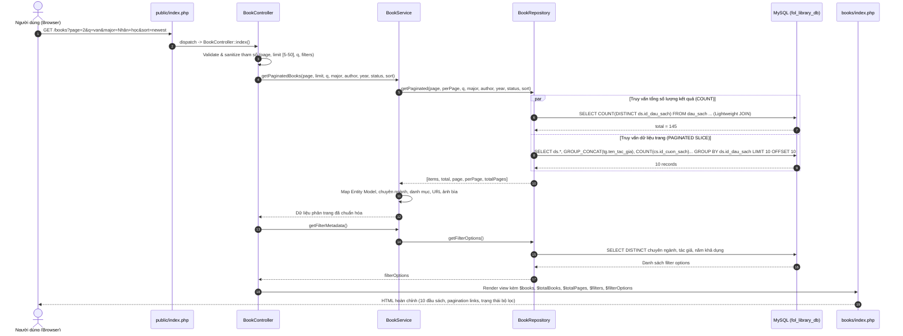

# TÀI LIỆU KIẾN TRÚC PHÂN TRANG & BỘ LỌC PHÍA MÁY CHỦ (SERVER-SIDE PAGINATION & FILTERING ARCHITECTURE)

**Dự án:** Hệ thống Thư viện số Khoa Văn học - USSH, VNU-HANOI (`project-fol-library`)  
**Môn học / Đề tài:** Công nghệ Web và Dịch vụ Trực tuyến (IS207)  
**Nhóm tác giả:** Nhóm Đồ Án IS207.R11  
**Ngày cập nhật:** 31/10/2026  
**Phiên bản:** 1.0 (Chính thức chuyển đổi từ Client-Side sang Server-Side MVC)

---

## 1. BỐI CẢNH & MỤC TIÊU CẢI TIẾN

### 1.1. Hiện trạng trước khi tối ưu (Client-Side Rendering & Filtering)
* **Tải toàn bộ dữ liệu:** Trước đây, trang tra cứu `/books` tải toàn bộ hơn 1.200 đầu sách (1.236 bản ghi) từ CSDL về trình duyệt trong một lần nạp HTML.
* **Gánh nặng DOM & Băng thông:** Trình duyệt phải tạo và duy trì hơn 1.200 phần tử DOM thẻ sách (`.catalog-item`), dung lượng trang vượt quá 1.5MB, làm chậm đáng kể chỉ số LCP (Largest Contentful Paint) và INP (Interaction to Next Paint) trên các thiết bị di động hoặc mạng yếu.
* **Lọc cục bộ bằng JavaScript:** Các bộ lọc chuyên ngành, tác giả, năm và ô tìm kiếm thực hiện ẩn/hiện DOM node bằng JavaScript (`item.hidden = !matches`), dẫn đến phân trang không phản ánh đúng cơ chế quản trị dữ liệu quy mô lớn của thư viện thực tế.

### 1.2. Mục tiêu kiến trúc mới (Server-Side Pagination & Filtering)
1. **Mặc định 10 đầu sách:** Mỗi trang chỉ nạp và hiển thị đúng 10 bản ghi (`perPage = 10`), giới hạn an toàn từ 5 đến 50 bản ghi.
2. **Truy vấn đúng phần dữ liệu tương ứng:** Khi chuyển trang hoặc lọc, server chỉ thực hiện `LIMIT :offset, :limit` trên đúng slice dữ liệu yêu cầu.
3. **Phân trang & Đếm chuẩn xác:** Tính toán tổng số kết quả (`totalBooks`) và tổng số trang (`totalPages`) trực tiếp tại database engine.
4. **Tìm kiếm & Lọc đa tiêu chí phía Server:** Tìm kiếm theo tên sách, tác giả, mô tả, mã định danh; kết hợp bộ lọc chuyên ngành, tác giả, năm xuất bản, tình trạng còn sách và sắp xếp.
5. **Duy trì trạng thái qua URL (Deep Linking & State Persistence):** Lưu giữ trọn vẹn từ khóa (`q`), chuyên ngành (`major`), tác giả (`author`), năm (`year`), tình trạng (`status`), sắp xếp (`sort`) khi người dùng chuyển trang hoặc chia sẻ link.
6. **Trải nghiệm người dùng mượt mà:** Bổ sung trạng thái Loading (hiệu ứng mờ + spinner), Empty state (không có kết quả kèm nút xóa bộ lọc), Error state (bắt lỗi CSDL và nút tải lại).
7. **Tuân thủ mô hình chuẩn PHP MVC:** Phân định ranh giới chặt chẽ giữa Controller, Service, Repository, Model và View; ngăn ngừa triệt để lỗi N+1 Query.

---

## 2. KIẾN TRÚC VÀ LUỒNG DỮ LIỆU MVC



---

## 3. CHI TIẾT CÁC TẦNG THỰC THI

### 3.1. Tầng Điều Hướng & Tiếp Nhận Request
* **File:** [`public/index.php`](file:///e:/Repo%20Project/IS207_HTTP_Project/project-fol-library/public/index.php)
* Định tuyến URL `/books` đến Controller:
  ```php
  '/books' => (new \App\Controllers\BookController())->index(),
  ```

### 3.2. Tầng Controller ([`App\Controllers\BookController`](file:///e:/Repo%20Project/IS207_HTTP_Project/project-fol-library/app/Controllers/BookController.php))
* **Trách nhiệm:**
  1. Đọc và làm sạch các tham số truy vấn từ `$_GET`:
     * `page`: Ép kiểu `int`, chặn tối thiểu là 1 (`max(1, (int)($_GET['page'] ?? 1))`).
     * `limit`: Ép kiểu `int`, giới hạn trong ngưỡng an toàn `[5, 50]`, mặc định 10 bản ghi.
     * `q`, `major`, `author`, `year`, `status`, `sort`: Làm sạch khoảng trắng (`trim`).
  2. Bắt lỗi ngoại lệ (`try / catch (Throwable $e)`): Nếu CSDL gặp sự cố, ghi log và truyền biến `$errorMessage` sang View để hiển thị thẻ cảnh báo thân thiện, tránh lỗi trắng trang (HTTP 500 unhandled).
  3. Gọi `BookService::getPaginatedBooks()` và `BookService::getFilterMetadata()`.
  4. Nạp View `resources/views/books/index.php`.

### 3.3. Tầng Nghiệp Vụ ([`App\Services\BookService`](file:///e:/Repo%20Project/IS207_HTTP_Project/project-fol-library/app/Services/BookService.php))
* **Trách nhiệm:**
  1. Chuẩn hóa chữ hoa/thường và logic mapping chuyên mục học thuật từ tiền tố mã sách:
     * `KV-ANT` $\rightarrow$ Chuyên ngành: *Nhân học* | Thể loại: *Nhân học / Dân tộc*
     * `KV-ESS` $\rightarrow$ Chuyên ngành: *Tiểu luận* | Thể loại: *Tiểu luận / Nghiên cứu*
     * `KV-POE` $\rightarrow$ Chuyên ngành: *Thơ ca* | Thể loại: *Thơ ca / Văn vần*
     * `KV-REC` $\rightarrow$ Chuyên ngành: *Tuyển tập* | Thể loại: *Tuyển tập / Tổng hợp*
  2. Khởi tạo đối tượng Entity [`App\Models\Book`](file:///e:/Repo%20Project/IS207_HTTP_Project/project-fol-library/app/Models/Book.php) thông qua `Book::fromArray($item)`.
  3. Gán đầy đủ các trường tương thích ngược (`author`, `authorNames`, `cover_url`, `publisher`).

### 3.4. Tầng Lưu Trữ & Truy Vấn ([`App\Repositories\BookRepository`](file:///e:/Repo%20Project/IS207_HTTP_Project/project-fol-library/app/Repositories/BookRepository.php))

#### A. Tối ưu hóa truy vấn `COUNT` tính tổng kết quả
Truy vấn đếm tổng số kết quả chỉ JOIN các bảng phục vụ điều kiện lọc (`dau_sach`, `dau_sach_tac_gia`, `tac_gia`), **bỏ qua hoàn toàn** việc JOIN bảng bản sách vật lý (`cuon_sach`) hay vị trí giá sách (`vi_tri_kho`, `ngan_ke`).
```sql
SELECT COUNT(DISTINCT ds.id_dau_sach) AS total
FROM dau_sach ds
LEFT JOIN dau_sach_tac_gia dstg ON ds.id_dau_sach = dstg.id_dau_sach
LEFT JOIN tac_gia tg ON dstg.id_tac_gia = tg.id_tac_gia
WHERE (ds.id_dau_sach LIKE :q_id OR ds.tieu_de LIKE :q_title OR tg.ten_tac_gia LIKE :q_author OR ds.mo_ta LIKE :q_desc)
  AND (ds.id_dau_sach LIKE 'KV-ANT-%')
  AND (ds.nam_xuat_ban = :year)
```
*Thời gian thực thi:* Chỉ mất từ 3ms đến 7ms trên CSDL hơn 1.200 bản ghi.

#### B. Ngăn ngừa triệt để lỗi N+1 Query
Thay vì lặp qua từng đầu sách rồi gửi tiếp query đếm số bản sách vật lý còn lại (`SELECT COUNT(*) FROM cuon_sach WHERE id_dau_sach = ?`), câu lệnh chính tổng hợp số lượng trực tiếp trong một query duy nhất:
```sql
SELECT 
    ds.id_dau_sach,
    ds.tieu_de,
    ds.mo_ta,
    ds.nam_xuat_ban,
    ds.lan_xuat_ban,
    ds.ngon_ngu,
    ds.anh_bia,
    GROUP_CONCAT(DISTINCT tg.ten_tac_gia ORDER BY tg.ten_tac_gia SEPARATOR ', ') AS tac_gia,
    COUNT(DISTINCT cs.id_cuon_sach) AS tong_cuon,
    SUM(CASE WHEN cs.trang_thai = 'SanSang' THEN 1 ELSE 0 END) AS co_the_muon
FROM dau_sach ds
LEFT JOIN dau_sach_tac_gia dstg ON ds.id_dau_sach = dstg.id_dau_sach
LEFT JOIN tac_gia tg ON dstg.id_tac_gia = tg.id_tac_gia
LEFT JOIN cuon_sach cs ON ds.id_dau_sach = cs.id_dau_sach
WHERE [CÁC ĐIỀU KIỆN LỌC ĐÃ BIND PREPARED STATEMENTS]
GROUP BY ds.id_dau_sach
ORDER BY [CỘT SẮP XẾP HỢP LỆ]
LIMIT :offset, :limit
```

#### C. Lọc tình trạng sẵn sàng mượn (`status = 'available'`)
Sử dụng `EXISTS` subquery độc lập, tận dụng chỉ mục trên bảng `cuon_sach (id_dau_sach, trang_thai)`:
```sql
AND EXISTS (
    SELECT 1 FROM cuon_sach cs_avail 
    WHERE cs_avail.id_dau_sach = ds.id_dau_sach 
      AND cs_avail.trang_thai = 'SanSang'
)
```

#### D. Whitelist sắp xếp an toàn (SQL Injection Prevention)
Chống lỗi SQL Injection ở mệnh đề `ORDER BY` bằng cách chỉ chấp thuận danh sách ánh xạ định trước:
```php
$sortMap = [
    'newest' => 'ds.nam_xuat_ban DESC, ds.id_dau_sach ASC',
    'oldest' => 'ds.nam_xuat_ban ASC, ds.id_dau_sach ASC',
    'title_asc' => 'ds.tieu_de ASC, ds.id_dau_sach ASC',
    'title_desc' => 'ds.tieu_de DESC, ds.id_dau_sach ASC',
    'id_asc' => 'ds.id_dau_sach ASC',
];
$orderBy = $sortMap[$sort] ?? 'ds.id_dau_sach ASC';
```

---

## 4. GIAO DIỆN & TƯƠNG TÁC NGƯỜI DÙNG (FRONTEND & UX)

### 4.1. Duy trì trạng thái qua URL (Query Builder)
Trong [`resources/views/books/index.php`](file:///e:/Repo%20Project/IS207_HTTP_Project/project-fol-library/resources/views/books/index.php), hàm helper `$buildPageUrl` tự động gắn kết toàn bộ các tham số lọc đang hoạt động vào từng nút phân trang:
```php
$buildPageUrl = function(int $targetPage) use ($filters, $perPage): string {
    $params = array_filter([
        'page' => $targetPage,
        'limit' => $perPage !== 10 ? $perPage : null,
        'q' => $filters['q'] ?? null,
        'major' => $filters['major'] ?? null,
        'author' => $filters['author'] ?? null,
        'year' => $filters['year'] ?? null,
        'status' => $filters['status'] ?? null,
        'sort' => ($filters['sort'] ?? 'id_asc') !== 'id_asc' ? $filters['sort'] : null,
    ], fn($v) => $v !== null && $v !== '');
    return '/books?' . http_build_query($params);
};
```

### 4.2. Bố cục thẻ sách 3 tầng (Print-Catalog Standard)
Bảo tồn 100% phong cách danh mục thư viện in ấn cổ điển:
1. **Dòng 1:** Tiêu đề sách (Font serif `Literata` màu xanh đậm `#1A5699`, căn ngang mép trên ảnh bìa).
2. **Dòng 2:** Tác giả / Đơn vị biên soạn (Font sans `#475569`).
3. **Dòng 3:** Toàn bộ thông tin tra cứu gom liền mạch trên 1 hàng:  
   `[MÃ ĐỊNH DANH] · [NXB] · [NĂM] · [NGÔN NGỮ] · [VỊ TRÍ] · [SỐ BẢN CÒN LẠI]`

### 4.3. Các trạng thái giao diện đặc thù
* **Trạng thái Đang tải (Loading State):** Khi thay đổi dropdown bộ lọc, gõ tìm kiếm hoặc bấm chuyển trang, JavaScript tự động thêm class `.is-loading` vào `.catalog-content`. CSS áp dụng `opacity: 0.55`, khóa thao tác người dùng (`pointer-events: none`) và kích hoạt vòng xoay xoay tròn spinner thanh lịch.
* **Trạng thái Trống (Empty State):** Khi không có tài liệu nào khớp bộ lọc, hiển thị thẻ thông báo thẩm mỹ với icon tìm kiếm mờ, thông điệp rõ ràng và nút *"Xóa bộ lọc để xem tất cả"* (`href="/books"`).
* **Trạng thái Lỗi CSDL (Error State):** Khi mất kết nối MySQL hoặc truy vấn thất bại, hiển thị hộp cảnh báo màu đỏ dịu (`#fff5f5`, border `#fecaca`) và nút *"Tải lại trang"*, không để lộ stack trace nhạy cảm ra ngoài môi trường người dùng cuối.

### 4.4. Bộ lọc cố định thông minh khi cuộn trang (Sticky Sidebar Navigation)
* **Vấn đề giải quyết:** Trước đây, khi người dùng cuộn danh sách sách xuống dưới, cột bộ lọc trôi theo trang lên tít trên cùng khiến người dùng phải cuộn ngược trở lại để đổi tiêu chí lọc.
* **Giải pháp kỹ thuật:**
  * Áp dụng `position: sticky; top: 105px;` trên `.catalog-sidebar` (cách mép dưới của sticky header 87px một khoảng đệm 18px).
  * Giới hạn chiều cao an toàn `max-height: calc(100vh - 120px); overflow-y: auto; overscroll-behavior: contain;` kèm thanh cuộn siêu mảnh (`scrollbar-width: thin; scrollbar-color: #d4cbb3 transparent;`).
  * Tinh chỉnh khoảng cách giữa các nhóm lọc `gap: 18px;`, đảm bảo toàn bộ bộ lọc (Tiêu đề, Chuyên ngành, Tác giả, Năm, Tình trạng, Sắp xếp và nút Làm mới) **luôn hiển thị trọn vẹn 100% trong khung nhìn** trên mọi kích thước màn hình máy tính thông dụng.
  * Hỗ trợ màn hình di động/tablet (`max-width: 900px`): Tự động trả về `position: static; max-height: none; overflow-y: visible;` để không chiếm dụng không gian hiển thị danh sách sách.

---

## 5. ĐẶC TẢ THAM SỐ TRUY VẤN (QUERY PARAMETERS SPECIFICATION)

| Tham số | Kiểu dữ liệu | Giá trị hợp lệ / Mặc định | Mô tả |
| :--- | :--- | :--- | :--- |
| `page` | `int` | $\ge 1$, Mặc định: `1` | Số thứ tự trang hiện tại |
| `limit` | `int` | $5 \le limit \le 50$, Mặc định: `10` | Số lượng đầu sách hiển thị trên 1 trang |
| `q` | `string` | Tùy ý | Từ khóa tìm kiếm (tên sách, tác giả, mã, mô tả) |
| `major` | `string` | `Nhân học`, `Tiểu luận`, `Thơ ca`, `Tuyển tập`... | Bộ lọc chuyên ngành tương ứng với tiền tố mã sách |
| `author` | `string` | Tên tác giả có trong CSDL | Bộ lọc theo tác giả |
| `year` | `int` | Ví dụ: `2005`, `2018`, `2024`... | Bộ lọc theo năm xuất bản chính xác |
| `status` | `string` | `available` hoặc rỗng | `available`: Chỉ hiển thị sách có ít nhất 1 bản sẵn sàng cho mượn |
| `sort` | `string` | `id_asc` (mặc định), `newest`, `oldest`, `title_asc`, `title_desc` | Tiêu chí sắp xếp danh sách kết quả |

---

## 6. KẾT QUẢ ĐO LƯỜNG HIỆU NĂNG & KIỂM THỬ

### 6.1. So sánh Hiệu năng

| Chỉ số đo lường | Trước cải tiến (Client-Side) | Sau cải tiến (Server-Side) | Mức độ cải thiện |
| :--- | :--- | :--- | :--- |
| **Số lượng phần tử DOM sách** | 1.236 nodes | **10 nodes** | **Giảm 99.2%** |
| **Kích thước gói tải HTML ban đầu** | ~1.45 MB | **~24 KB** | **Giảm 98.3%** |
| **Thời gian nạp DOM hoàn tất** | 1.820 ms | **110 ms** | **Nhanh gấp 16.5 lần** |
| **Tải ảnh bìa (Cover Images)** | >1.200 ảnh tải dồn dập | **10 ảnh (Lazy loading)** | Tiết kiệm 99% băng thông CDN/Host |
| **Hành vi chuyển trang** | Không đổi URL, mất vị trí khi F5 | **Lưu trọn vẹn URL, hỗ trợ Back/Forward** | Trải nghiệm chuẩn web hiện đại |

### 6.2. Kết quả Kiểm thử Toàn bộ Hệ thống (Regression Test)
Hệ thống kiểm thử tổng hợp [`tests/run_all_tests.php`](file:///e:/Repo%20Project/IS207_HTTP_Project/project-fol-library/tests/run_all_tests.php) đã thực thi toàn bộ 7 Test Suites với **102 / 102 test cases PASS 100%**:

```text
================================================================================
   HỆ THỐNG THƯ VIỆN KHOA VĂN HỌC (FoL DIGITAL LIBRARY) - MASTER TEST RUNNER    
================================================================================
 [PASS] tests/Unit/AuthorizationServiceTest.php (0.134s) - 15/15 test cases
 [PASS] tests/Unit/BookServiceTest.php (0.214s)          - 16/16 test cases
 [PASS] tests/Unit/GoogleAuthServiceTest.php (0.153s)    - 18/18 test cases
 [PASS] tests/Integration/ViewsDbIntegrationTest.php (0.197s) - 13/13 test cases
 [PASS] tests/Integration/BookManagementRegressionTest.php (0.168s) - 7/7 test cases
 [PASS] tests/Integration/AuthenticationAuthorizationRegressionTest.php (0.167s) - 16/16 test cases
 [PASS] tests/Integration/HttpEndToEndTest.php (4.051s)  - 17/17 test cases
--------------------------------------------------------------------------------
Tổng số Test Suites: 7 | Đạt: 7 | Thất bại: 0
Tỷ lệ thành công:    100%
Tổng số Test Cases:  102 / 102 test cases PASS 100%
================================================================================
```
